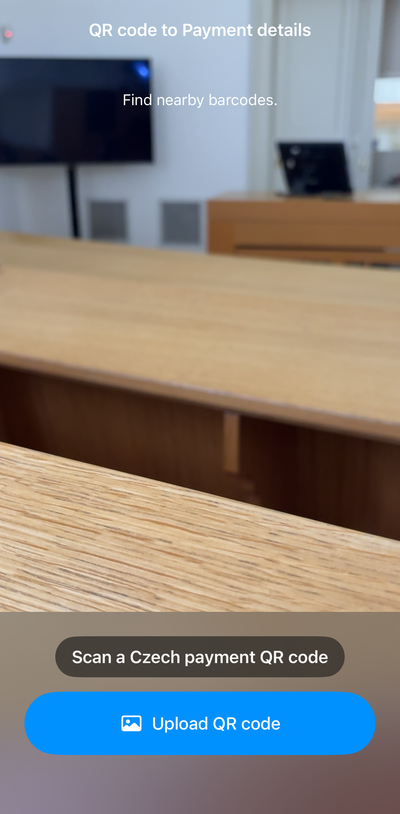
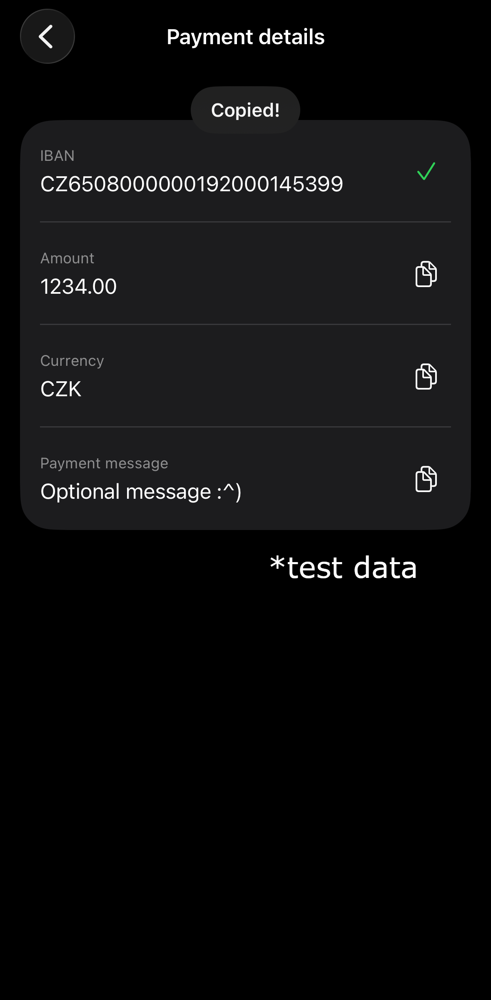

# QR CZ

An iOS app that reads Czech payment QR (SPD 1.0) codes and displays payment details for copying into another banking or transfer app. The app does not initiate payments.

## Motivation

Shawarma shop next to my house only accepts cash or QR code payments. Since I don’t always have money on my Czech card, I built this app for myself and others in need. Czech payment QR codes can contain an IBAN, amount, and other transfer details. QR CZ makes those values readable and easy to copy into another app.

## Technologies

- Swift and SwiftUI
- VisionKit and Vision for QR scanning and image decoding
- PhotosUI for the privacy-preserving photo picker
- AVFoundation for camera permission and availability
- UIKit pasteboard for copying values

## MVC architecture

- **Model:** `CzechPayment` stores the parsed payment details; `SPDParser` reads SPD 1.0 fields and validates the IBAN checksum
- **View:** SwiftUI screens show the live scanner, photo picker, status messages, and copyable payment details
- **Controller:** `PaymentFlowController` coordinates QR image decoding, parsing, errors, and navigation state

## Features

- Scan Czech SPD 1.0 QR codes with the camera or choose an image that contains a QR code from Photos
- Display the IBAN, recipient name and BIC/SWIFT, amount, currency, variable symbol, and payment message when present
- Copy each value individually
- Keep decoding and parsing on the device; the app does not upload QR data

## Privacy

Live scanning requires camera access. For image upload, the app uses Apple's system `PhotosPicker`. iOS grants access only to the image the user chooses, so the app does not need permission to read the whole photo library. QR decoding and payment parsing happen locally on the device.

## Using the details for an international transfer

In a transfer service such as Wise or Revolut, start a bank transfer, copy the values from QR CZ into the matching fields in the transfer app.

Transfer routes and required recipient information vary by provider, country, and currency. A QR code may not contain every detail a provider requires. Follow the provider's prompts and ask the recipient for any missing information; **do not guess**.

QR CZ only displays and copies details. It does not send money or guarantee that a particular transfer route is available.

## Build and run

Open `qr-cz.xcodeproj` in Xcode and run on an iPhone or iPad. The first launch asks for camera access. If access is denied, enable it for QR CZ in Settings or upload a QR code. Live camera scanning may be unavailable in the iOS Simulator; the photo picker can be used there to try QR decoding and the payment details screen.

## Demo

1. Scan or upload a QR code

2. Copy payment details

## License

This project is available under the MIT License.